<div align="center">

<picture>
  <source media="(prefers-color-scheme: dark)" srcset=".github/readme/banner-dark.svg">
  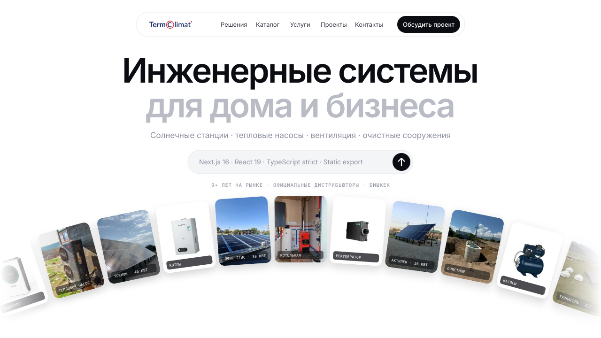
</picture>

<br>

[](https://nextjs.org)
[](https://react.dev)
[](https://www.typescriptlang.org)
[](#деплой)
[](#типизация)

**[Страницы](#страницы)** &nbsp;·&nbsp;
**[Быстрый старт](#быстрый-старт)** &nbsp;·&nbsp;
**[Архитектура](#архитектура)** &nbsp;·&nbsp;
**[Дизайн-система](#дизайн-система)** &nbsp;·&nbsp;
**[Деплой](#деплой)**

</div>

<br>

> **TermoClimat** проектирует, поставляет, монтирует и обслуживает инженерные системы в Кыргызстане. Это редизайн сайта [termoclimat.kg](https://termoclimat.kg). Сайт многостраничный, сделан в минималистичном стиле с крупной типографикой, тёмными секциями и реальными фото с объектов компании.

<br>

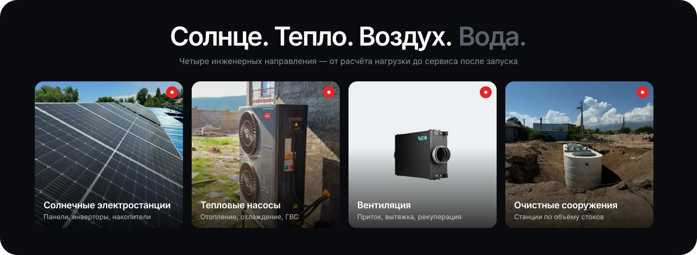

<br>

## Как выглядит

<table>
  <tr>
    <td width="50%">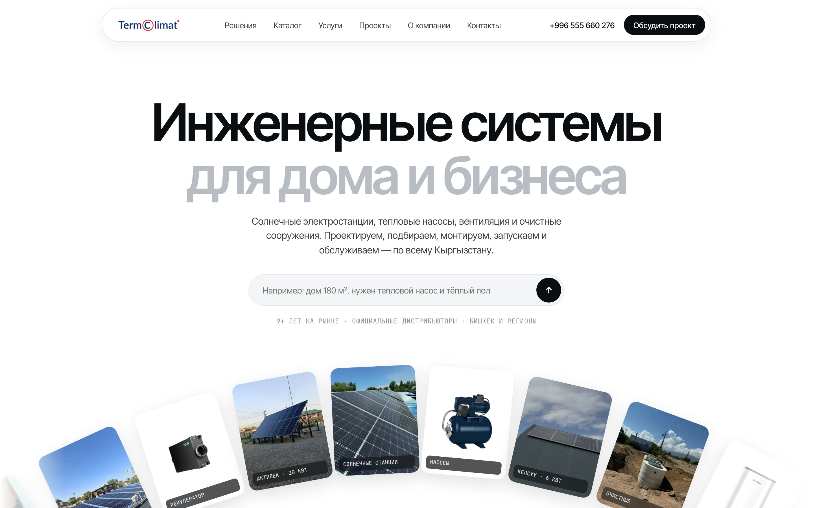</td>
    <td width="50%">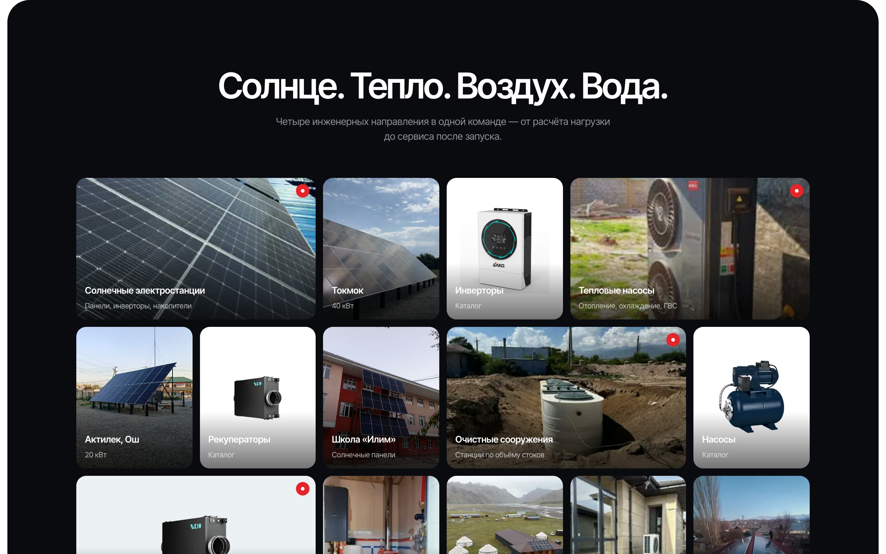</td>
  </tr>
  <tr>
    <td align="center"><sub><b>Hero</b> · строка «опишите задачу» и лента фото по дуге</sub></td>
    <td align="center"><sub><b>Направления</b> · сетка фото с объектов</sub></td>
  </tr>
  <tr>
    <td width="50%">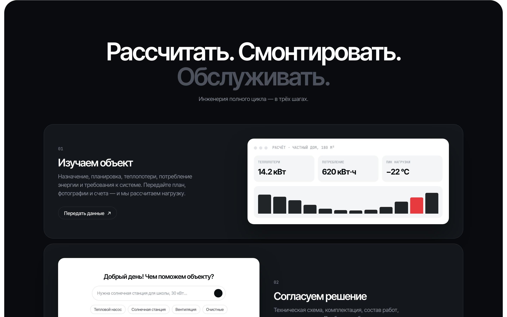</td>
    <td width="50%">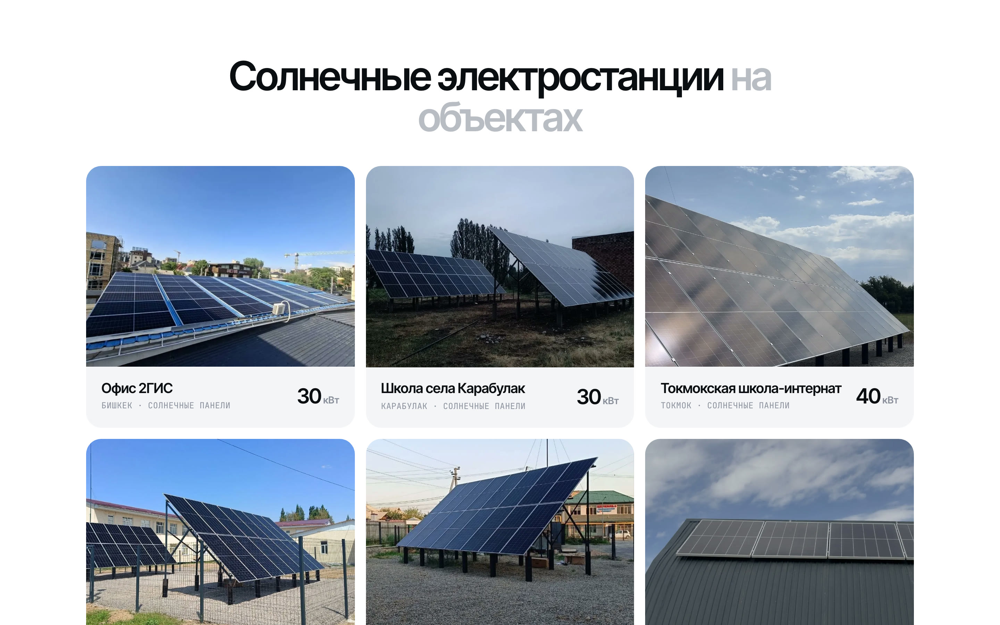</td>
  </tr>
  <tr>
    <td align="center"><sub><b>Три шага</b> · макеты интерфейса расчёта и спецификации</sub></td>
    <td align="center"><sub><b>Проекты</b> · 7 объектов и галерея с фильтрами</sub></td>
  </tr>
</table>

<table>
  <tr>
    <td width="33%">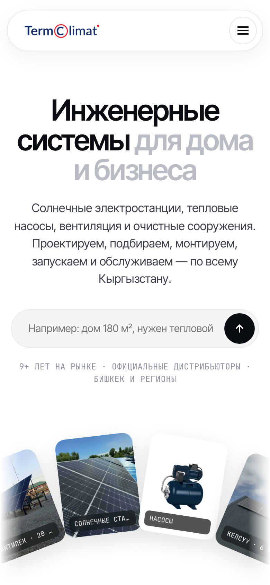</td>
    <td width="33%">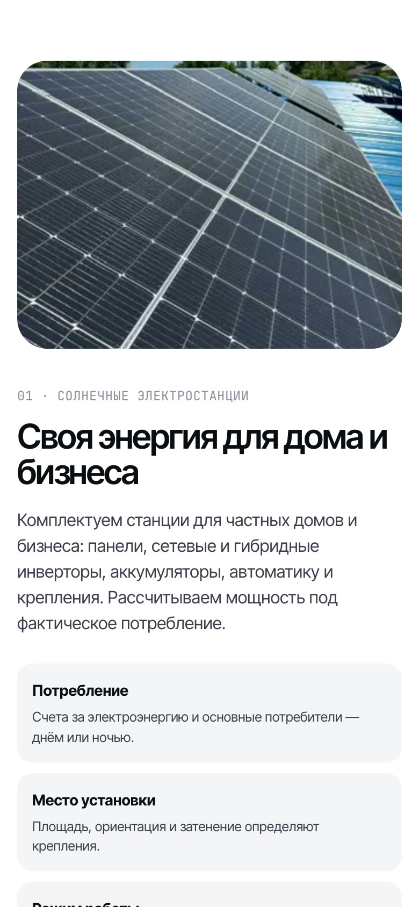</td>
    <td width="33%">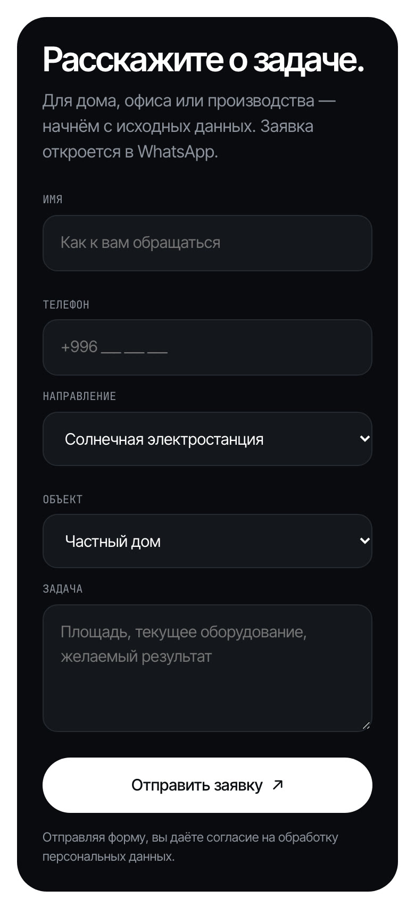</td>
  </tr>
  <tr>
    <td align="center"><sub>Главная · 390 px</sub></td>
    <td align="center"><sub>Решения · 390 px</sub></td>
    <td align="center"><sub>Заявка · 390 px</sub></td>
  </tr>
</table>

<br>

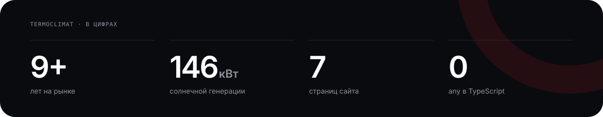

## Страницы

| Маршрут | Файл | Что на странице |
|:--|:--|:--|
| `/` | `web/app/page.tsx` | Hero с лентой по дуге, направления, кейсы, три шага, вкладки решений, каталог, форматы работы, CTA |
| `/solutions/` | `web/app/solutions/page.tsx` | 4 направления с этапами подбора, якоря `#solar` `#heatpump` `#ventilation` `#wastewater`, FAQ |
| `/services/` | `web/app/services/page.tsx` | 7 услуг, порядок «Как начать работу» |
| `/projects/` | `web/app/projects/page.tsx` | Цифры, 7 объектов с мощностью, галерея из 38 фото с фильтрами |
| `/catalog/` | `web/app/catalog/page.tsx` | 8 категорий оборудования, акции `#sale`, гарантия и доставка |
| `/about/` | `web/app/about/page.tsx` | О компании, этапы работы, партнёры и сертификаты `#certs` |
| `/contacts/` | `web/app/contacts/page.tsx` | Телефоны, адрес, 2ГИС, форма заявки `#form`, доставка и оплата `#delivery`, карта |

## Быстрый старт

```bash
cd web
npm install
npm run dev        # → http://localhost:3000
```

```bash
npm run build      # статическая сборка в web/out/
npm start          # просмотр собранной версии
```

> [!TIP]
> Весь контент лежит в одном файле **`web/lib/data.ts`**: контакты, решения, услуги, объекты, галерея, каталог и FAQ. Поменяйте текст там, и он обновится на всех страницах.

## Архитектура

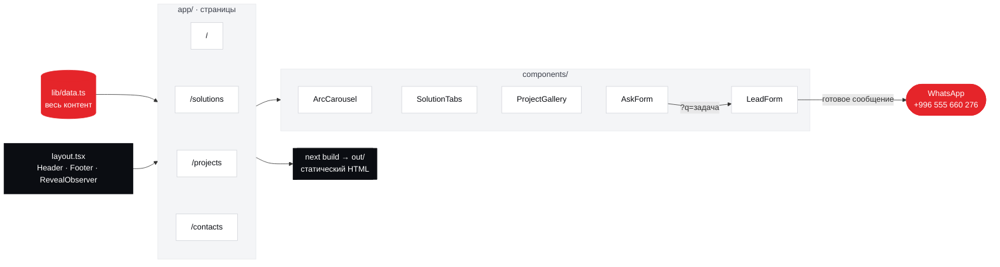

<details>
<summary><b>Структура проекта</b></summary>

```text
termoclimat/
├── web/                         ← Next.js-версия (основная)
│   ├── app/
│   │   ├── layout.tsx           шрифты, метаданные, Header/Footer
│   │   ├── globals.css          дизайн-система
│   │   ├── page.tsx             главная
│   │   ├── solutions/ services/ projects/ catalog/ about/ contacts/
│   │   └── not-found.tsx        404
│   ├── components/
│   │   ├── Header.tsx           меню, активный пункт, мобильное меню
│   │   ├── Footer.tsx           колонки ссылок и надпись termoclimat
│   │   ├── ArcCarousel.tsx      лента фото по дуге (requestAnimationFrame)
│   │   ├── SolutionTabs.tsx     вкладки направлений
│   │   ├── ProjectGallery.tsx   галерея с фильтрами
│   │   ├── AskForm.tsx          «опишите задачу» → форма заявки
│   │   ├── LeadForm.tsx         заявка → WhatsApp
│   │   ├── RevealObserver.tsx   появление блоков при скролле
│   │   └── ui.tsx               PageHero, SectionTitle, Cta, Arrow
│   ├── lib/data.ts              весь контент сайта
│   └── public/assets/           фото объектов, товары, сертификаты, логотип
├── site/                        ← статический HTML-прототип
├── pages/ · partials/ · build.py   исходники прототипа
└── .github/readme/              графика для этого README
```

</details>

## Интерактив

| Компонент | Что делает |
|:--|:--|
| **ArcCarousel** | Карточки плывут по параболе с наклоном по касательной. На паузе при наведении, учитывает `prefers-reduced-motion` |
| **AskForm** | Текст из hero передаётся в `/contacts/?q=…#form` и подставляется в поле «Задача» |
| **LeadForm** | Собирает имя, телефон, направление и объект и открывает WhatsApp с готовым сообщением. Бэкенд не нужен |
| **SolutionTabs** | Тепловые насосы, солнечные станции, вентиляция и очистные. Для каждого направления показано, что проверяем до покупки |
| **ProjectGallery** | Фильтры: солнечные станции, отопление, резервуары, частные дома, коммерческие объекты |
| **RevealObserver** | Плавное появление секций. Перезапускается при переходах между страницами |

## Типизация

- `strict: true`, в коде нет ни одного `any`
- Направления и категории галереи описаны союзами литералов (`Solution['id']`, `GalleryCat`), фильтры и вкладки проверяются компилятором
- Поля формы типизированы через `LeadData` и обобщённый обработчик `update<K extends keyof LeadData>`

## Дизайн-система

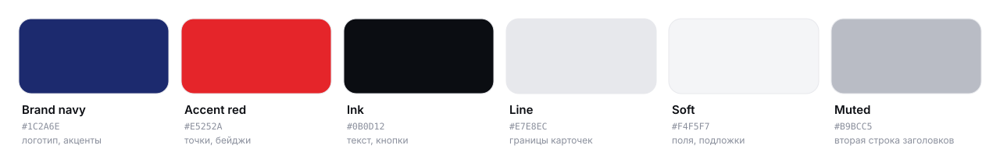

| Элемент | Решение |
|:--|:--|
| Заголовки | **Inter Tight 600**, `letter-spacing: -0.04em`. Вторая часть заголовка набрана серым |
| Подписи | **JetBrains Mono**, капс, 12 px |
| Кнопки | Пилюли: чёрная основная, белая на тёмном фоне, контурная |
| Секции | Белые чередуются с тёмными `#0A0B0F`, у тёмных радиус 36 px |
| Цвета | Тёмно-синий и красный взяты из логотипа |
| Адаптив | Точки перелома 1080 / 900 / 600 px, бургер-меню, без горизонтального скролла |

Шрифты подключены через `next/font` с кириллицей и раздаются с вашего домена.

## Деплой

Сборка лежит в `web/out/`. Это обычные HTML-файлы, их можно разместить где угодно.

| Хостинг | Как |
|:--|:--|
| **Vercel** | Импортируйте репозиторий, Root Directory: `web` |
| **Netlify / Cloudflare Pages** | Build: `npm run build`, Publish: `web/out` |
| **Обычный хостинг** | Загрузите содержимое `web/out/` по FTP |

> [!NOTE]
> Чтобы заявки приходили в Telegram или CRM, уберите `output: 'export'` в `web/next.config.ts` и добавьте route handler.

<details>
<summary><b>Статический HTML-прототип (<code>site/</code>)</b></summary>

<br>

Первая версия на чистом HTML, CSS и JS без зависимостей.

```bash
python3 build.py                       # pages/* + partials/* → site/*.html
python3 -m http.server -d site 8080    # → http://localhost:8080
```

- `pages/`: контент страниц. Первая строка задаёт метаданные: `<!-- title | description | nav-key -->`
- `partials/`: общие шапка и подвал

</details>

<details>
<summary><b>Обновить графику README</b></summary>

<br>

Баннеры, блок направлений, цифры, палитру и надпись создаёт скрипт. Фото встраиваются прямо в SVG, потому что GitHub не подгружает внешние картинки внутри SVG.

```bash
python3 .github/readme/generate.py     # нужен ffmpeg
```

</details>

<br>

<div align="center">

<picture>
  <source media="(prefers-color-scheme: dark)" srcset=".github/readme/wordmark-dark.svg">
  
</picture>

**Бишкек, ул. Абдымомунова, 145** &nbsp;·&nbsp; [+996 555 660 276](tel:+996555660276) &nbsp;·&nbsp; [info@termoclimat.kg](mailto:info@termoclimat.kg) &nbsp;·&nbsp; [WhatsApp ↗](https://wa.me/996555660276)

<sub>Будни 08:00–17:00</sub>

</div>
